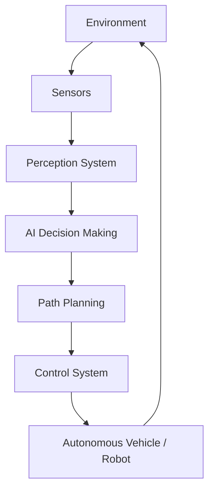

<div align="center">

# 🤖 AUTONOMOUS VEHICLES & ROBOTICS

### Engineering Intelligent Autonomous Systems

**Sense. Think. Navigate. Act.**

Exploring intelligent mobility, robotics, autonomous navigation, computer vision, and AI-driven automation.

[](https://github.com/Malik4896/Autonomous-vehicles-and-Robotics)
[](https://github.com/Malik4896)
[](https://github.com/Malik4896)

</div>

---

## 🚀 About The Project

**Autonomous Vehicles and Robotics** is a technology-focused project exploring intelligent autonomous systems and modern robotics concepts.

The project focuses on understanding how autonomous machines perceive their surroundings, process information, make decisions, and perform actions with minimal human intervention.

It brings together concepts from Artificial Intelligence, Machine Learning, Computer Vision, Robotics, and Automation.

## 🎯 Project Objectives

- Understand autonomous vehicle technologies.
- Explore intelligent robotic systems.
- Study sensor-based environment perception.
- Explore computer vision applications.
- Understand autonomous navigation.
- Investigate AI-based decision-making.
- Explore real-world robotics applications.

## ✨ Key Technology Areas

### 🚗 Autonomous Vehicles
- Autonomous driving concepts.
- Environment perception.
- Path planning.
- Obstacle detection.
- Intelligent mobility.

### 🤖 Robotics
- Robot control systems.
- Motion planning.
- Robotic automation.
- Intelligent robot behavior.
- Human-robot interaction.

### 👁️ Computer Vision
- Object detection.
- Image processing.
- Lane detection.
- Environment understanding.
- Visual perception.

### 🧠 Artificial Intelligence
- Machine Learning.
- Deep Learning.
- Intelligent decision-making.
- Predictive systems.
- AI-based automation.

## 🛠️ Technologies

Potential technologies for this domain include:

| Category | Technologies |
|---|---|
| Programming | Python, C++, Java |
| AI/ML | TensorFlow, PyTorch |
| Computer Vision | OpenCV |
| Robotics | ROS, ROS 2 |
| Hardware | Arduino, Raspberry Pi |
| Simulation | Gazebo, CARLA |
| Development | Git, GitHub |

*The actual technologies used depend on the implementations in this repository.*

## 🏗️ Autonomous System Architecture



## 🌍 Real-World Applications

- Autonomous transportation.
- Smart mobility systems.
- Industrial robotics.
- Warehouse automation.
- Agricultural robotics.
- Intelligent surveillance.
- Autonomous delivery systems.
- Search and rescue robotics.

## 📸 Project Demonstrations

Add actual project images, simulation screenshots, or hardware demonstrations here.

```markdown


```

## 🚀 Future Exploration

- Advanced autonomous navigation.
- AI-powered obstacle avoidance.
- Real-time object detection.
- Multi-robot coordination.
- Intelligent path optimization.
- Sensor fusion.
- Autonomous driving simulation.

## 🤝 Contributions

Contributions and suggestions are welcome.

1. Fork the repository.
2. Create a feature branch.
3. Implement your changes.
4. Commit and push.
5. Submit a Pull Request.

## 👨‍💻 Author

**Abdul Malik B J**

GitHub: [@Malik4896](https://github.com/Malik4896)

Repository: [Autonomous Vehicles and Robotics](https://github.com/Malik4896/Autonomous-vehicles-and-Robotics)

---

<div align="center">

### 🚀 Building the Future of Intelligent Mobility

**Think Intelligent. Move Autonomous.**

⭐ Star this repository if you find it interesting!

</div>
